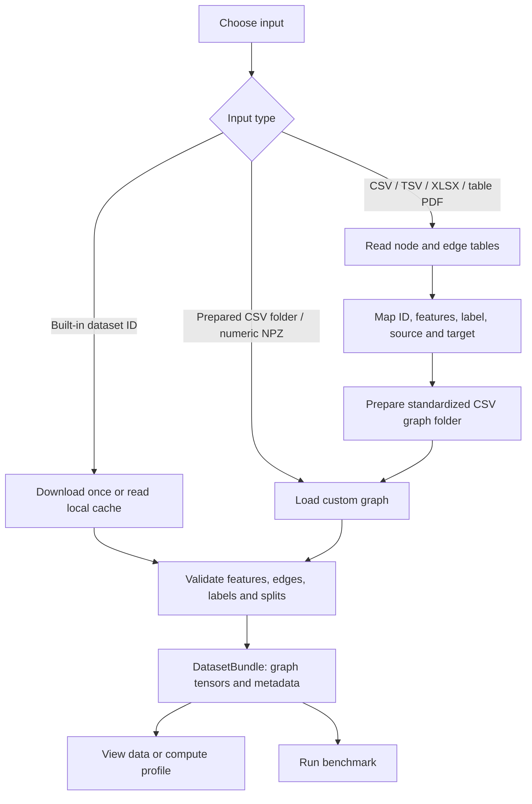
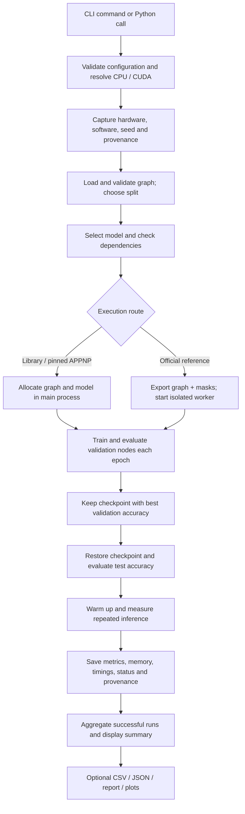
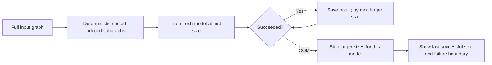

# EfficientGraphBench: architecture, functions and workflow

This guide describes the current local implementation as inspected on 3 October 2026, including the dataset profiling changes that have not yet been pushed. It describes implemented behavior, not a future implementation plan.

**Purpose:** give the same graph dataset to selected node-classification models, train and evaluate them, measure their resource use, and produce reproducible comparison records.

Open the [interactive architecture diagram](architecture.html). The diagrams below explain the input, training and failure workflows separately.

## 1. What the system is

EfficientGraphBench is an installable Python package with two user interfaces: Python functions for scripts/Jupyter, and the `egbench` terminal command. Both reach the same benchmark engine. It runs on the machine hosting that Python process, using its CPU or CUDA GPU.

The current task is **multiclass node classification**: predict one class for each node. For example, in Cora, nodes are papers, features describe papers, edges are citation relationships, and the target is the paper's subject class. The model learns using training labels; validation labels select the checkpoint; test labels measure its final accuracy.

There is no web server, database server, distributed scheduler or automatic connection to the college GPU. An SSH session or remotely hosted Jupyter kernel places Python on the college machine; the package then uses that machine's GPU.

## 2. Architecture and source locations

All paths in this table are under `src/efficientgraphbench/`.

| Component | Responsibility | Implementation |
|---|---|---|
| Terminal interface | Parse commands, display tables, invoke the engine | `cli/main.py` |
| Python interface | Construct single, repeated and scaling experiments | `api/benchmark.py` |
| Configuration | Validate model, training, dataset and device options | `config.py` |
| Dataset layer | Catalogue, download, load, prepare and validate graphs | `datasets/catalog.py`, `registry.py`, `loaders.py`, `custom.py`, `prepare.py`, `validation.py` |
| Data exploration | Read input tables and generate searchable data sheets | `datasets/tables.py`, `viewer.py` |
| Dataset profiling | Compute graph, feature and class statistics | `datasets/profile.py` |
| Experiment controller | Execute one run, a model/seed matrix or size experiments | `benchmark/runner.py`, `matrix.py`, `scaling.py` |
| Shared input contract | Export canonical graph arrays, split masks and hashes | `benchmark/interchange.py` |
| Model selection | Resolve implementation, source and execution route | `models/catalog.py`, `registry.py`, `metadata.py`, `provenance.py` |
| Reference environments | Install and inspect pinned repositories and Python environments | `environments/manager.py`, packaged environment resources |
| Execution | Run in-process models or launch/check reference workers | `benchmark/execution.py`, `runners/reference_worker.py` |
| Training and evaluation | Seed, optimize, select a checkpoint and evaluate | `training/trainer.py`, `seed.py`, `evaluator.py` |
| Resource measurement | Hardware information, latency and memory | `profiling/hardware.py`, `runtime.py` |
| Result storage | Structured run records, statuses and current-result files | `results/schema.py`, `status.py`, `writer.py` |
| Analysis | Summaries, reports, recommendations and plots | `api/results.py`, `results/report.py`, `recommend.py`, `plots.py` |

The diagram's database symbols mean files and cached datasets on disk; the project does not use a database service. The two model execution branches are alternatives for a run, not simultaneous training workers. Profiling and viewing are separate actions that can load the dataset without launching an experiment.

## 3. Input workflow: how data becomes a graph



### Required graph representation

| Field | Shape | Meaning |
|---|---|---|
| `x` | `N × F` | Numeric feature values: one row per node |
| `edge_index` | `2 × E` | Source and target node indices for every stored edge |
| `y` | `N` | Class label per node; supported unlabeled nodes use `-1` |
| `train_mask` | `N` | Nodes whose labels are used to learn |
| `val_mask` | `N` | Nodes used to select the best checkpoint |
| `test_mask` | `N` | Nodes used for final evaluation |

`N` is the number of nodes, `E` the number of stored directed edge entries, and `F` the number of features. An undirected connection can be stored as two reciprocal entries. These edge counts should not be confused with unique undirected pairs.

The loader checks edge endpoints, numeric finite features, label validity, and nonempty disjoint evaluation masks. It records graph fingerprints and preprocessing information. Preprocessing is dataset-specific: for example, several citation/Amazon/Coauthor loaders normalize features, and ogbn-arxiv is converted to an undirected graph. Reference adapters may use preserved raw features according to their recipes.

### Custom input requirements

Provide a **node table** containing a unique node ID, numeric features and a class label, and an **edge table** containing source and target IDs. Existing split assignments can be supplied; otherwise preparation generates a stratified split when the class counts allow it. Ambiguous column names require explicit mapping.

A random spreadsheet is not automatically a graph. The package does not invent relationships between rows, choose the prediction target, encode arbitrary text into embeddings, or read scanned PDFs with OCR. PDF import requires extractable tables; Excel/PDF inputs with multiple possible tables require selection.

Preparation preserves copies of original tables alongside standardized `nodes.csv`, `edges.csv` and preparation metadata. Built-in dataset views expose the data actually supplied by the benchmark, which may be numeric features rather than original paper text or original business records.

### Registered datasets

| Family | Dataset IDs |
|---|---|
| Citation | `cora`, `citeseer`, `pubmed` |
| Amazon co-purchase | `amazon-computers`, `amazon-photo` |
| Coauthor | `coauthor-cs`, `coauthor-physics` |
| Other graph benchmarks | `wikics`, `flickr` |
| OGB | `ogbn-arxiv`, `ogbn-products` |
| Heterophilous benchmarks | `roman-empire`, `amazon-ratings`, `actor`, `texas`, `wisconsin` |
| User data | `custom` |

Registration means a loader exists; it does not guarantee that every model fits that graph in memory. The OGB integration currently covers the two listed homogeneous node-classification datasets.

## 4. Model execution routes

| Display name / identifier | Actual implementation | Execution |
|---|---|---|
| GCN / `gcn` | PyTorch Geometric `GCN` | Main process |
| GraphSAGE / `graphsage` | PyTorch Geometric `GraphSAGE` | Main process |
| GAT / `gat` | PyTorch Geometric `GAT` | Main process |
| GATv2 / `gatv2` | PyTorch Geometric `GAT(v2=True)`, using `GATv2Conv` | Main process |
| APPNP / `appnp` | Pinned, unchanged PyG citation-example `Net`, using APPNP propagation | Main process |
| SGC / `sgc` | PyTorch Geometric `SGConv` | Main process |
| MLP / `mlp` | PyTorch Geometric `MLP`; feature-only baseline | Main process |
| SGFormer / `sgformer` | Pinned official SGFormer repository | Separate reference environment |
| GraphGPS / `graphgps` | Pinned official GraphGPS `GPSModel` with the selected node-classification recipe | Separate reference environment |
| SGFormer (PyG) / `sgformer_pyg` | PyTorch Geometric `SGFormer` alternative | Main process; explicitly select it |
| Graphormer / `graphormer` | Official repository identity registered, but no validated adapter for this task | Returns `UNSUPPORTED_TASK` |

`sgformer_reference` is an alias for the official SGFormer route. `models="all"` selects the ten primary identifiers, including Graphormer; it does not add `sgformer_pyg`. Therefore selecting all does not imply every row will succeed.

The MLP baseline does not use graph edges. GCN, GraphSAGE, GAT, GATv2, APPNP and SGC are graph neural models; SGFormer and GraphGPS combine graph processing with attention. The maintained PyG SGFormer and the official SGFormer use different implementation/configuration choices and should retain their separate identities in results.

Reference workers receive graph arrays and split information through files, execute using their pinned environment, and return structured results. The controller checks graph/split identity and hardware identity before accepting measurements. Setup and dependency availability are platform-specific: automatic Linux setup currently covers GraphGPS, while the official SGFormer setup route is more restricted. Check `egbench environments` before planning a reference run.

The old custom Graphormer implementation is absent. There is no current active 4096-node Graphormer training limit to explain; its current blocker is the missing validated task adapter.

## 5. End-to-end lifecycle of one benchmark run



1. **Validate the request.** Unknown models, invalid options, unavailable explicitly requested CUDA, or missing environments become errors rather than fabricated results. `device="auto"` can choose CPU when CUDA is unavailable.
2. **Load the dataset.** First use can download and process it; later runs can use cached data. This affects preprocessing time.
3. **Fix the split and random seed.** A seed controls stochastic behavior; changing it does not necessarily change the train/test split.
4. **Create the model.** Input width comes from the dataset features and output width from its classes. The implementation is selected from the registry.
5. **Train.** The current trainers use the full graph. A forward pass computes node predictions; the classification loss uses training labels; backpropagation updates model weights.
6. **Validate.** Validation accuracy is checked during training. The best validation checkpoint is retained. Test labels are not used to choose it.
7. **Test.** Restore that checkpoint and calculate accuracy on the test mask.
8. **Measure inference.** Run warmups followed by repeated timed forward passes. CUDA synchronization makes timing meaningful. This is full-graph inference, not per-node request latency.
9. **Save and summarize.** Store the complete record and aggregate successful runs. Failed/skipped attempts remain identifiable without numeric accuracy values.

For in-process models, the default trainer uses Adam, 200 epochs, learning rate 0.01 and weight decay 0.0005. Reference models follow their adapter recipes, including model-specific optimization choices. These runs compare the configured implementations; they do not automatically reproduce every paper's best reported result.

## 6. Repeats, splits, scaling and failures

### Repeated experiments

| Selection | What varies |
|---|---|
| `seeds=[1,2,3]` | Explicit training seeds |
| `runs=10` | Generates seeds 1 through 10 |
| `splits="fixed"` | Keeps one dataset split; varies training seeds |
| `splits="official"` | Cycles the dataset's official folds where available |
| `splits="random"` | Generates stratified 60/20/20 splits per seed |

Do not supply both `runs` and `seeds`. Texas and the listed heterophilous datasets have ten official folds; WikiCS has twenty. Datasets with one official split retain that split when repeating it. Random splits on OGB are nonofficial protocols.

Jobs run sequentially: one model and seed at a time. Ten seeds with seven models request seventy runs. Summary `runs` counts successful runs; `attempted_runs` also reflects failure/skip records; `distinct_splits` counts successful split identities.

### Graph-size experiments



`ScalingBenchmark`/`scale` varies **nodes**, not language-model tokens. It trains a new model on each selected induced subgraph. It does not train one large graph in chunks or resume a smaller model as the graph grows. Subgraph accuracy is not the full-dataset accuracy. Use fixed/official split settings for this path; random split handling is not consistently propagated through the current scaling loader.

### Failure handling

| Status | Meaning |
|---|---|
| `SUCCESS` | Run completed and produced measurements |
| `OOM` | Memory allocation failed |
| `UNSUPPORTED_GRAPH_SIZE` | Implementation explicitly rejects that size |
| `UNSUPPORTED_TASK` | Model adapter does not support this task |
| `CONFIG_ERROR` | Invalid configuration, including unavailable requested CUDA |
| `DEPENDENCY_ERROR` | Required dependency/source is missing or incompatible |
| `ENVIRONMENT_NOT_INSTALLED` | Reference environment is absent |
| `PREPROCESSING_ERROR` | Dataset/model preprocessing failed |
| `RUNTIME_ERROR` | Other execution failure |
| `RESOURCE_LIMIT` | Resource limit such as worker timeout |
| `SKIPPED_AFTER_OOM` | Later run skipped after an OOM for that model |
| `SKIPPED_DETERMINISTIC_FAILURE` | Later run skipped after a pretraining deterministic failure |

After the first OOM, remaining seeds for that model are skipped and other models continue. This is a scheduling policy, not a claim that every skipped seed was actually tested and exhausted memory. Selected deterministic pretraining errors also trigger skipping. Records retain the dataset/model, graph size and hardware where available, plus failure stage/reason and applicable limit information.

## 7. All supported terminal commands

Use `egbench --help` for the command list and `egbench COMMAND --help` for every option. `python -m efficientgraphbench` provides the same interface. The table covers nineteen distinct command functions; `scaling` is also registered as an alias for `scale`.

| Command | Function | Example |
|---|---|---|
| `datasets` | List supported datasets | `egbench datasets` |
| `models` | List models or show one model's information | `egbench models gcn` |
| `hardware` | Show the current machine's hardware | `egbench hardware` |
| `preview` | Show columns and first five rows of an input table | `egbench preview --file data/Mydata/nodes.csv` |
| `view` | Save a searchable HTML data sheet | `egbench view --dataset cora` |
| `prepare` | Map node/edge tables into a validated custom dataset | `egbench prepare --nodes data/Mydata/nodes.csv --edges data/Mydata/edges.csv --output-dir data/prepared` |
| `inspect` | Validate a graph and show sizes, splits and model parameter estimates | `egbench inspect --dataset cora` |
| `profile` | Compute the detailed dataset profile | `egbench profile --dataset cora` |
| `run` | Run one model and seed | `egbench run --dataset cora --model gcn --device auto` |
| `matrix` | Compare selected models across specified seeds | `egbench matrix --dataset cora --models gcn,gat --seeds 1,2,3 --device auto` |
| `repeat` | Run N seeds with fixed, official or random splits | `egbench repeat --dataset texas --models gcn,mlp --runs 10 --splits official --device auto` |
| `scale` | Test increasing subgraph sizes | `egbench scale --help` |
| `scaling` | Alias for `scale` | `egbench scaling --help` |
| `compare` | Display the current stored comparison | `egbench compare --dataset cora --output-dir experiments/demo` |
| `report` | Write a report from stored results | `egbench report --dataset cora --output-dir experiments/demo` |
| `plot` | Export accuracy/latency and GPU allocation charts | `egbench plot --summary experiments/demo/summary.csv --output-dir experiments/demo/plots` |
| `recommend` | Filter measured models by accuracy/resource constraints | `egbench recommend --help` |
| `provenance` | Export implementation-source information | `egbench provenance` |
| `setup` | Install a supported reference environment | `egbench setup graphgps` |
| `environments` | Inspect reference environment availability | `egbench environments` |

`prepare` may need `--node-id`, `--label`, `--source`, `--target` and `--features` if the column names cannot be inferred uniquely. `setup` can download dependencies; inspection/training can download uncached datasets. Viewing, profiling and plotting do not train models. Top-level `--install-completion` installs shell completion, and `--show-completion` prints the completion script.

## 8. Supported Python interface

These are the user-facing objects and operations; internal helpers implement the architecture above and are not separate user workflows.

| Import / object | Operation | Result |
|---|---|---|
| `efficientgraphbench.Benchmark` | `Benchmark(...).run()` | `BenchmarkResults` for a comparison |
| `Benchmark` | `Benchmark.run_model(model, dataset=..., **options)` | One `BenchmarkResult` |
| `efficientgraphbench.ScalingBenchmark` | `ScalingBenchmark(...).run()` | Scaling experiment results |
| `efficientgraphbench.BenchmarkResult` | Properties, `to_dict()` | Metrics, status, source, hardware and failure details |
| `efficientgraphbench.BenchmarkResults` | Iterate, index, `len(...)` | Access individual run records |
| `BenchmarkResults` | `to_dataframe()` | Full per-run pandas table |
| `BenchmarkResults` | `summary(across_splits=...)` | Aggregated comparison table |
| `BenchmarkResults` | `save_json`, `save_jsonl`, `save_csv`, `save_markdown` | Export to an explicit path |
| `efficientgraphbench.HardwareProfile` | `collect()`, `to_dict()` | Current host hardware information |
| `efficientgraphbench.datasets.load_dataset` | `load_dataset(name, root="data", ...)` | Validated `DatasetBundle` |
| `DatasetBundle` | `.data` | Graph tensors: features, edges, labels and masks |
| `DatasetBundle` | `.metadata()` | Counts, split and preprocessing metadata |
| `DatasetBundle` | `.profile()` | Detailed `DatasetProfile` |
| `efficientgraphbench.datasets.profile_dataset` | `profile_dataset(name_or_bundle, ...)` | Detailed `DatasetProfile` |
| `DatasetProfile` | `print(...)`, `to_dict()`, key access, `save_json(path)` | Display/access/export statistics |
| `efficientgraphbench.results.plots.plot_summary` | `plot_summary(summary_dataframe_or_csv, output_dir)` | Export chart files |

See [Python command examples](../PYTHON_COMMANDS.md) and [full option reference](../PYTHON_API_REFERENCE.md) for extended syntax. For the exact installed CLI options, command-specific `--help` is authoritative; there is no registered `table` command (use `preview` or `view`).

## 9. Dataset profile: what each value means

| Value | Definition in the current profiler |
|---|---|
| Nodes / edges / features / classes | Dataset dimensions; edges are stored entries |
| Density | Unique non-self directed arcs divided by `N(N−1)` |
| Average / median / maximum degree | Outgoing degree on those unique non-self arcs, including isolated nodes |
| Homophily | Same-label arcs divided by arcs whose two endpoints are labeled |
| Class imbalance | Largest/smallest labeled class count: low ≤1.5, moderate ≤3, high >3 or a missing class |
| Connected components | Weakly connected components, including isolated nodes |
| Largest component | Percentage of all nodes in the largest weak component |
| Feature sparsity | Percentage of exact zero feature values; uses retained raw features when available |

These definitions matter for directed graphs, duplicate edges and self-loops. Undefined metrics are marked unavailable rather than invented. Profiling uses sparse graph operations and chunked feature counting; loading the dataset still requires memory. It is a separate command and is not automatically included in benchmark training time. See [profiling details](dataset_profiling.md).

## 10. Measurements and saved output

| Measurement | Interpretation |
|---|---|
| Test accuracy mean ± SD | Mean and sample standard deviation across successful runs |
| Preprocessing time | Dataset loading/preparation; first downloads/caches affect it |
| Training time | Measured training work; detailed records separate additional phases |
| Inference latency | Timed repeated full-graph forward passes after warmup; summary averages run medians |
| GPU allocated memory | Peak memory occupied by tensors tracked by PyTorch |
| GPU reserved memory | Peak memory held by PyTorch's caching allocator |
| CPU memory | Sampled process resident memory, not total system RAM consumption |
| Detailed breakdown | Stage timings/memory and graph, parameter, gradient and optimizer tensor sizes |

Stage peak counters can be cumulative; do not add them together as independent memory costs. Memory samples and allocator counters are measurements of this execution protocol, not architectural constants.

```text
data/                                  downloaded and prepared datasets
experiments/<chosen-output>/
  configs/                             per-run configurations
  logs/                                controller logs
  checkpoints/                         in-process checkpoints
  graph-cache/                         reusable canonical graph archives
  exchange/<run-id>/                   reference request/result, worker log/checkpoint
  raw/results.jsonl                    current structured result rows
  raw/results.csv                      current rows as a CSV
  raw/<run-id>.json                     individual stored record
  summary.csv                          written by repeat or explicit Python export
  runs.json                            written by repeat or explicit Python export
  reports/                             generated reports when requested
  plots/                               PNG/PDF charts and plot_data.csv when requested
```

Scaling also writes its own scaling result/summary files and size-specific run directories. A profile JSON is written only when an output path is requested.

Current-result tables are updated/replaced according to batch/model/seed identity; they are not an append-only history of every experiment. Older logs/configurations/checkpoints can remain. Use different output directories to preserve independent experiments.

For multiple official folds, use the repeated experiment's `results.summary()`/`summary.csv`. The `compare` path chooses a latest comparison group and can show only the latest fold rather than the whole multi-fold aggregate.

Charts show test accuracy versus inference latency, and mean peak allocated GPU memory per model. They use saved results and require no GPU. CPU-only results have no GPU allocation chart. Recommendations filter compatible measured results; they do not tune models or predict performance on unseen hardware.

## 11. Complete Python example

Run this in the Python environment on the machine you want to benchmark. On college hardware, that means the remote terminal's Python or the remote Jupyter kernel.

```python
from pathlib import Path
from efficientgraphbench import Benchmark, HardwareProfile
from efficientgraphbench.datasets import profile_dataset
from efficientgraphbench.results.plots import plot_summary

# 1. Check the execution host and inspect the dataset.
print(HardwareProfile.collect().to_dict())
print(profile_dataset("cora"))

# 2. Train two implementations across ten seeds, on the fixed split.
results = Benchmark(
    dataset="cora",
    models=["gcn", "graphsage"],
    runs=10,
    splits="fixed",
    epochs=200,
    device="cuda",  # Requires working CUDA on this Python host.
    output_dir="experiments/cora-demo",
).run()

# 3. Read the comparison and retain detailed records.
summary = results.summary()
print(summary)
out = Path("experiments/cora-demo")
summary.to_csv(out / "summary.csv", index=False)
results.save_json(out / "runs.json")

# 4. Generate charts from the saved measurements (plot extra required).
plot_summary(summary, out / "plots")
```

To use a prepared custom graph, select `dataset="custom"` and pass `dataset_path="data/prepared"`. To compare ten official Texas folds, select `dataset="texas"`, `runs=10`, `splits="official"`. Add reference models only after their required environments are installed and available.

## 12. Current boundaries

The current engine supports full-graph node classification on one host. It does not implement neighbor-sampled mini-batch training, distributed/multi-GPU training, arbitrary graph/link prediction tasks, automatic hyperparameter search, arbitrary database connectors or automatic graph construction from unrelated tables.

More GPU memory increases the feasible graph size but does not eliminate preprocessing costs or model-specific complexity. GraphGPS currently includes expensive positional encoding preprocessing and dense global attention, so large graphs can fail before or during training. There is no single universal maximum node count for all models; features, edges, width, layers, precision and implementation all affect memory.

## Diagram verification

Diagram type: architecture. The delivered HTML passed all 9 showcase artifact checks with 0 errors and 0 warnings. Browser checks passed at 1440×900, 1600×1000, 1920×1080 and 2048×1320; light/dark screenshots were inspected. Visual review: passed. Correction rounds: 0.

Specification SHA-256: `20041015616efaf989e2ecdfdec8decf324c544d2681642b820b199014901f72`.

HTML SHA-256: `268cb572462ad725ec99840369a1f92829768147ae64c69708f052f29828d723`.
